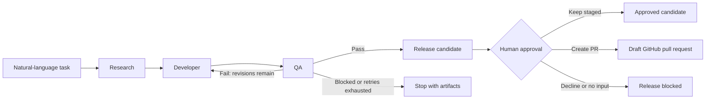

# Agentic Harness

Agentic Harness is a Python command-line tool that turns a natural-language software task into a four-stage LangGraph workflow: Research creates a design specification, Developer implements it, QA tests and reviews the result in Docker, and Release prepares the output for human approval. It supports new standalone projects or changes to an existing repository, saves run artifacts for review, and works with Groq, Gemini, or a compatible model endpoint.

## Example: build a GitHub organization connector

Given the [GitHub members task](examples/github-members-task.txt), the harness extends an existing Python integration library with a connector that lists organization members, handles pagination and errors, and includes mocked HTTP tests.

The recorded demo completed the full workflow: QA found two failing tests on the first attempt, one Developer revision brought the suite to **14 passing tests**, and human approval produced a draft pull request. See the [demo walkthrough and recorded outcome](examples/README.md).

Each run produces an engineering specification, generated files and their manifest, QA reports for each attempt, and a release candidate with a review report.

## Demo materials

The [demo folder](demo/README.md) brings together the [presentation slides](demo/Agentic%20Harness.pdf), [recorded run artifacts](demo/example_run/cb0753f0de4d473b92e05d8a086ff4ac/), and the demo video link (to be added after upload).

## Architecture



Research creates the engineering specification from the task and available context. Developer proposes files, which trusted tools validate and stage. QA runs Python checks in Docker and assesses the implementation against the specification. Failed QA can return feedback to Developer, bounded by `--max-dev-revisions`. Release verifies the approved QA artifacts and prepares the candidate for a human decision. Failed or blocked stages stop progression and retain diagnostic artifacts.

For a code review, start with:

| Location | What to inspect |
| --- | --- |
| [graph.py](src/harness/graph.py) | Stage transitions, terminal states, and the bounded repair loop |
| [stages/](src/harness/stages/) | Coordination, validation, and artifact handling for each stage |
| [agents/](src/harness/agents/) | Model instructions and structured generation or assessment |
| [tools/](src/harness/tools/) | Repository inspection, file validation, Docker execution, and release controls |
| [models.py](src/harness/models.py) | Typed contracts for tasks, generated files, QA, and release |
| [tests/](tests/) | Unit tests and workflow tests, including repair and failure paths |

## Setup

You need Python 3.11 or newer, a model provider API key, and **Docker installed and running**. Start Docker Desktop (or the Docker daemon) before running the harness; QA requires access to it. The first run automatically builds the QA image and needs network access.

From the project root, create and activate a virtual environment:

```bash
python -m venv .venv
```

On Windows PowerShell:

```powershell
.\.venv\Scripts\Activate.ps1
```

On macOS or Linux:

```bash
source .venv/bin/activate
```

Alternatively, if you have Conda installed, create and activate a Conda environment with Python 3.12:

```bash
conda create -n harness python=3.12
conda activate harness
```

With either environment active, install the project and its dependencies:

```bash
python -m pip install -e .
```

Copy `.env.example` to `.env` in the project root (`Copy-Item .env.example .env` in PowerShell, or `cp .env.example .env` on macOS/Linux). Set `LLM_PROVIDER` and the corresponding API key. The default is Groq, so replace the `GROQ_API_KEY` placeholder with your key. The same [.env.example](.env.example) includes settings for Gemini and compatible endpoints.

Confirm Docker is reachable:

```bash
docker info
```

## Run

After setup, run the GitHub connector example from the project root with the environment active.

On Windows PowerShell:

```powershell
$taskText = Get-Content examples/github-members-task.txt -Raw
harness "$taskText" --repository examples/integration-demo --runs-dir runs --max-dev-revisions 2
```

On macOS or Linux:

```bash
harness "$(cat examples/github-members-task.txt)" --repository examples/integration-demo --runs-dir runs --max-dev-revisions 2
```

See the [example walkthrough](examples/README.md) for baseline checks, expected artifacts, and the recorded demo result. For a standalone project, provide a task without `--repository`:

```bash
harness "Implement an addition utility with tests" --runs-dir runs
```
Note: _The task description should ideally be more detailed than the example above._

Artifacts are saved under `runs/<run-id>/`. After QA passes, the terminal prompts for release approval; see [Release](#release) below for staging and pull request options.

You can also run the CLI with `python -m harness.main`.

## Release

After QA passes, Release prepares a candidate and asks `Approve this release candidate? [y/N]`. If approved, choose one of these options:

- `staged` (default): keeps the approved output in the run's release directory.
- `pr` (requires `--repository`): pushes a new branch and opens a draft GitHub pull request for review and merging. The original working tree remains unchanged.

**Creating a pull request requires Git and `gh` (GitHub CLI) installed and available on your PATH.** Authenticate before running the harness:

```bash
gh auth login
```

Configure your Git author (`user.name` and `user.email`) and ensure you have push access to the target repository's GitHub `origin`. The repository must be clean, with its current branch synchronized with origin. Standalone runs support staging only.

Release requires interactive approval. Rejecting the candidate or running without terminal input blocks release and preserves the candidate for review. Release decisions and results are saved in the run's release directory.

## Development

Install the development dependencies and run the tests:

```bash
python -m pip install -e ".[dev]"
python -m pytest -q
```

Live Groq tests are opt-in with `RUN_LIVE_GROQ=1`; leave it unset for offline tests.


## Scope and limitations

- **Python-focused execution:** executable QA checks currently cover Python syntax and pytest tests in Docker. Other languages and arbitrary build or test commands are not supported by the executor.
- **File operations:** Developer supports creating files and replacing existing files in full. Patch-based edits, file deletion, and renaming are not supported operations. Existing files must be fully available to the agent and pass validation before replacement.
- **Controlled execution:** generated code runs in restricted Docker containers with networking disabled during tests. Model calls, research retrieval, and initial image or dependency provisioning require external access.
- **Reviewable release:** `staged` retains an approved candidate under the run directory; `pr` pushes a new branch and opens a draft GitHub pull request after human approval. Neither mode merges or deploys the result, and the original target working tree remains unchanged.
- **Validation boundaries:** passing generated tests and model-based requirements review supports human review; it does not establish production readiness or successful integration with a live external service. Model outputs and repair counts can vary between runs.
